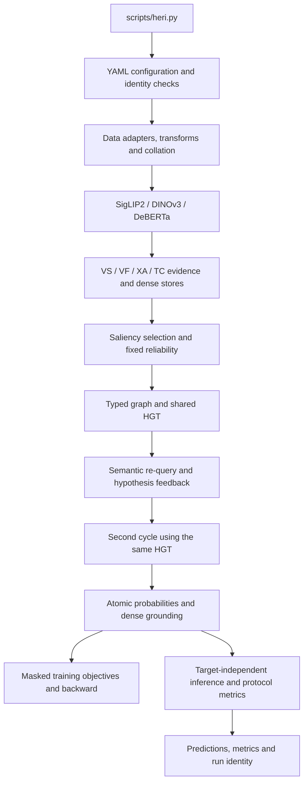

# Architecture and code navigation

The package has one data-to-result pipeline. Configuration loading and orchestration select a dataset/model; tensor contracts connect the individual stages. Modules remain separate when they own a mathematical operation or protocol, and shared fixtures connect their tests.

## Ownership map

| Package under `src/heri/` | Responsibility | Verification |
| --- | --- | --- |
| `data/` | Ontologies, availability masks, geometry, tokenizer alignment, loaders, preflight and SAMM reconstruction | Data unit tests; adapter integration tests |
| `models/encoders/` | Backbone loading, output shapes and frozen/unfrozen behavior | Model unit tests; real weights required for full runtime checks |
| `evidence/` | Four projected families, saliency/diversity selection and dense stores | Evidence unit tests; equation contracts |
| `routing/` | One-time reliability, gates and Eq.30 calibration | Routing unit tests; equation contracts |
| `graph/` | Schema, edges, confidence, shared HGT, refresh and registered controls | Graph unit tests; actual-edge contracts |
| `models/heri/` | Composition of evidence, routing, reasoning and prediction heads | Connected synthetic integration tests |
| `models/heads/` | Atomic prediction, stable Noisy-OR, bilinear grounding and shared box regressor | Model/loss unit tests; grounding formulas |
| `models/baselines/`, `models/fusion/` | Backbone-matched B0/B1 controls | Baseline unit and integration tests |
| `losses/` | Supervision masks, objectives and valid-population reductions | Loss unit tests; hand-computed contracts |
| `training/` | Stages, optimizer, global schedule, precision, identity and resume | Training unit tests; runtime contracts |
| `evaluation/`, `metrics/` | Aggregation, inverse geometry, released SAMM projection and artifact export | Metrics unit tests; integration and equation contracts |
| `experiments/` | Variant materialization, matched runs and aggregation | Experiment contracts |
| `utils/`, `compat/`, `thresholding/` | Configuration, fingerprints, library compatibility and diagnostic policies | Configuration/runtime contracts |

## Trace a change

Start with the relevant row of the [equation map](method/paper_contract.md). Follow its implementation into the owning package and inspect that package's input/output dataclasses. Then check a small unit case, its mathematical invariant and the connected integration test. This makes formula changes visible at both the operation and pipeline boundaries.

[models/heri/model.py](../src/heri/models/heri/model.py) composes the canonical model. [training/heri_trainer.py](../src/heri/training/heri_trainer.py) controls training; [evaluation/heri_run.py](../src/heri/evaluation/heri_run.py) controls inference and artifact export. Baseline trainers and evaluators share the same dataset and metric contracts. Registered studies declare the mechanisms, readouts and training objectives changed by each comparison.

## Data and supervision boundaries

Adapters expose labels and separate annotation-availability masks. Inference consumes inputs and geometry metadata; target labels must not determine predictions. Losses use validity masks to define supervision. Evaluators use the masks to define diagnostic populations while retaining samples for classification.

Graph budgeting reduces reasoning nodes while dense evidence remains available to grounding. Reliability is computed once; later cycles update relation neighborhoods/confidences from evolved states. The second cycle reuses the first cycle's parameters. [Graph reasoning](method/graph_reasoning.md) specifies the refresh controls and readouts.

## Generated files

Source, configuration, tests and documentation are versioned. Datasets belong in `data/`; generated outputs belong in `artifacts/`. Validation uses temporary storage outside the source tree and writes only its compact report directory into `artifacts/validation/latest/`.

Run through `python -B scripts/heri.py ...` to suppress Python bytecode in the launcher and child processes. Validation also disables pytest caching. Generated caches and model artifacts are excluded from version control.
